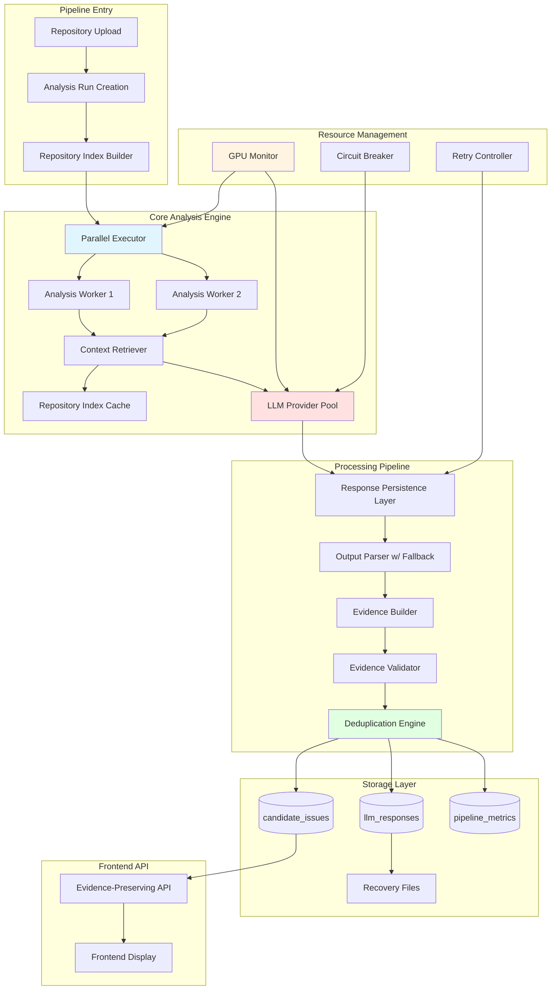

# Technical Design Specification: LLM Pipeline Improvements

## Overview

This design addresses critical architectural gaps in the BugTracker LLM-based bug detection pipeline, transforming it from a proof-of-concept into a production-ready system. The audit identified 15 architectural gaps, 7 drop points where findings can be lost, limited 8KB context windows, sequential execution bottlenecks, and information loss across layers.

### Design Goals

1. **Context Enhancement**: Expand from 8KB to 32KB context with comprehensive cross-file analysis through Repository_Index
2. **Information Preservation**: Eliminate all 7 drop points through persistent storage, evidence tracking, and audit trails
3. **Parallel Execution**: Enable concurrent processing within RTX 2050 4GB GPU constraints (max 2 concurrent LLM calls)
4. **Resource Efficiency**: Operate within hardware constraints through dynamic throttling and intelligent caching
5. **Resilience**: Implement comprehensive error handling, retry logic, and graceful degradation
6. **Incremental Analysis**: Support fast re-scans through file hashing and dependency tracking

### Key Architectural Principles

- **Fail-Safe by Default**: All operations must handle errors gracefully without losing data
- **Audit Everything**: Complete traceability from raw LLM response to frontend display
- **Resource-Aware**: Continuously monitor and adapt to hardware constraints
- **Evidence-First**: Every finding must carry complete supporting evidence
- **Idempotency**: Operations should be safely retryable without side effects

## Architecture

### System Architecture Diagram



### Component Interaction Flow

1. **Indexing Phase**: Repository_Index builds comprehensive call graphs, type information, and cross-file relationships
2. **Scheduling Phase**: Parallel_Executor distributes functions across workers within GPU constraints
3. **Context Assembly**: Context_Retriever builds 32KB context packages from Repository_Index
4. **LLM Inference**: LLM_Provider_Pool manages concurrent requests with GPU monitoring
5. **Persistence Phase**: Raw responses stored immediately before any processing
6. **Validation Phase**: Evidence_Builder and Evidence_Validator ensure completeness
7. **Deduplication Phase**: Deduplication_Engine merges duplicates while preserving all evidence
8. **API Layer**: Frontend_API returns complete records without filtering

## Components and Interfaces

### 1. Repository Index Builder

**Purpose**: Pre-build comprehensive repository metadata for efficient context retrieval.

**Responsibilities**:
- Parse all Python files and build AST-based index
- Build call graphs (caller → callee relationships)
- Extract type annotations, function signatures, class definitions
- Detect cross-file dependencies and data flow paths
- Cache index to disk for incremental updates
- Compute file content hashes for change detection

**Interface**:

```python
@dataclass
class FunctionSignature:
    name: str
    qualname: str
    parameters: List[Parameter]
    return_type: Optional[str]
    decorators: List[str]
    docstring: Optional[str]
    file_path: str
    line_start: int
    line_end: int

@dataclass
class CallRelationship:
    caller_qualname: str
    callee_qualname: str
    call_site_line: int
    is_cross_file: bool
    
@dataclass
class RepositoryIndexData:
    functions: Dict[str, FunctionSignature]  # qualname -> signature
    classes: Dict[str, ClassDefinition]
    call_graph: Dict[str, List[CallRelationship]]  # caller -> callees
    reverse_call_graph: Dict[str, List[str]]  # callee -> callers
    type_definitions: Dict[str, TypeInfo]
    imports: Dict[str, List[ImportInfo]]
    file_hashes: Dict[str, str]  # file_path -> content_hash
    index_metadata: IndexMetadata

class RepositoryIndexBuilder:
    def build_index(self, repo_path: str) -> RepositoryIndexData:
        """Build complete repository index. Time budget: <30s for 10K LOC."""
        pass
    
    def update_incremental(self, 
                          previous_index: RepositoryIndexData,
                          changed_files: List[str]) -> RepositoryIndexData:
        """Update index for changed files only."""
        pass
    
    def save_to_cache(self, index: RepositoryIndexData, cache_path: str):
        """Persist index to disk for reuse."""
        pass
    
    def load_from_cache(self, cache_path: str) -> Optional[RepositoryIndexData]:
        """Load cached index if available."""
        pass
```

**Implementation Details**:
- Uses Python `ast` module for parsing
- Implements visitor pattern for AST traversal
- Stores index in MessagePack format for fast serialization
- Indexes stored at `.bugtracker/cache/{repo_id}/index.msgpack`
- Cache invalidation based on file hash comparison

### 2. Context Retriever (Enhanced)

**Purpose**: Build rich 32KB context packages from Repository_Index for LLM analysis.

**Enhancements from Current Implementation**:
- Expand MAX_CONTEXT_CHARS from 6000 to 32000
- Add type definition retrieval
- Add cross-file caller/callee summaries
- Add data flow context (value producers/consumers)
- Implement retry logic for missing symbols
- Track context completeness percentage

**Enhanced Interface**:

```python
@dataclass
class ContextPackage:
    target_function: FunctionSignature
    target_source: str
    enclosing_class: Optional[ClassDefinition]
    direct_callees: List[FunctionSummary]
    direct_callers: List[FunctionSummary]
    type_definitions: List[TypeInfo]
    related_classes: List[ClassSummary]
    imports: List[ImportInfo]
    cross_file_references: List[CrossFileRef]
    total_size_chars: int
    completeness_percentage: float  # 0-100
    retrieval_metadata: RetrievalMetadata

class EnhancedContextRetriever:
    def __init__(self, repository_index: RepositoryIndexData):
        self.index = repository_index
        self.cache = LRUCache(maxsize=500)
    
    def retrieve_context(self, 
                        function_qualname: str,
                        context_budget: int = 32000) -> ContextPackage:
        """
        Build context package with:
        - Target function full source
        - Enclosing class if applicable
        - Direct callees (signatures + docstrings)
        - Direct callers (signatures)
        - Type definitions used
        - Cross-file references
        
        Guarantees:
        - Total size ≤ context_budget
        - Completeness tracking
        - Fallback to partial context on errors
        - Retry logic for transient failures
        """
        pass
    
    def get_cross_file_context(self, 
                               function_qualname: str,
                               max_depth: int = 2) -> List[CrossFileRef]:
        """Extract cross-file call chains up to max_depth."""
        pass
```

**Context Budget Allocation**:
- Target function source: 40% (12.8KB)
- Direct callees: 25% (8KB)
- Direct callers: 15% (4.8KB)
- Type definitions: 10% (3.2KB)
- Related classes: 10% (3.2KB)

### 3. Parallel Executor

**Purpose**: Orchestrate concurrent function analysis within hardware constraints.

**Interface**:

```python
@dataclass
class WorkerConfig:
    max_concurrent_llm_calls: int = 2
    gpu_memory_threshold_mb: float = 3800.0
    throttle_at_memory_percent: float = 80.0
    worker_queue_size: int = 100
    batch_db_write_size: int = 10

@dataclass
class AnalysisTask:
    function_qualname: str
    file_path: str
    priority: int
    context_package: Optional[ContextPackage] = None

class ParallelExecutor:
    def __init__(self, 
                 config: WorkerConfig,
                 repository_index: RepositoryIndexData,
                 llm_provider_pool: LLMProviderPool,
                 gpu_monitor: GPUMonitor):
        self.config = config
        self.index = repository_index
        self.llm_pool = llm_provider_pool
        self.gpu_monitor = gpu_monitor
        self.task_queue = asyncio.Queue(maxsize=config.worker_queue_size)
        self.results_buffer = []
    
    async def execute_analysis(self, 
                              functions: List[str],
                              analysis_run_id: str) -> AnalysisResults:
        """
        Execute parallel analysis with:
        - Max 2 concurrent LLM calls
        - GPU memory monitoring
        - Dynamic throttling
        - Batch database writes
        - Error isolation per function
        
        Returns summary with success/failure counts.
        """
        pass
    
    async def _worker(self, worker_id: int):
        """
        Worker coroutine that:
        1. Retrieves task from queue
        2. Checks GPU memory availability
        3. Builds context if not cached
        4. Calls LLM via provider pool
        5. Persists raw response
        6. Buffers results for batch write
        """
        pass
    
    def _adjust_concurrency(self):
        """
        Dynamically adjust concurrent workers based on:
        - Current GPU memory usage
        - Error rates
        - Response latencies
        """
        pass
```

**Concurrency Control**:
- Default: 2 concurrent LLM inference calls
- If GPU memory > 80%: reduce to 1 concurrent call
- If GPU memory > 90%: pause new tasks until memory drops
- Context building happens in parallel with LLM calls (separate thread pool)
- Database writes batched every 10 results or 5 seconds

### 4. LLM Provider Pool

**Purpose**: Manage LLM provider instances with resource monitoring and circuit breaker.

**Interface**:

```python
@dataclass
class LLMCallMetadata:
    request_id: str
    prompt_tokens: int
    response_tokens: int
    latency_ms: float
    model_name: str
    gpu_memory_used_mb: float
    timestamp: datetime

class LLMProviderPool:
    def __init__(self, 
                 provider: LLMProvider,
                 max_concurrent: int = 2,
                 circuit_breaker: CircuitBreaker):
        self.provider = provider
        self.semaphore = asyncio.Semaphore(max_concurrent)
        self.circuit_breaker = circuit_breaker
        self.metrics_collector = MetricsCollector()
    
    async def generate_with_monitoring(self, 
                                      prompt: str,
                                      request_id: str) -> LLMResponse:
        """
        Generate LLM response with:
        - Semaphore-based concurrency control
        - Circuit breaker protection
        - GPU memory monitoring
        - Latency tracking
        - Automatic retry on transient failures
        
        Returns raw response + metadata.
        """
        async with self.semaphore:
            if not self.circuit_breaker.is_closed():
                raise CircuitBreakerOpenError("LLM provider unavailable")
            
            try:
                start_time = time.time()
                gpu_before = self.gpu_monitor.get_memory_usage()
                
                response = await self._call_with_timeout(prompt, timeout=30.0)
                
                latency = (time.time() - start_time) * 1000
                gpu_after = self.gpu_monitor.get_memory_usage()
                
                metadata = LLMCallMetadata(
                    request_id=request_id,
                    prompt_tokens=len(prompt) // 4,  # rough estimate
                    response_tokens=len(response) // 4,
                    latency_ms=latency,
                    model_name=self.provider.model,
                    gpu_memory_used_mb=gpu_after - gpu_before,
                    timestamp=datetime.utcnow()
                )
                
                self.circuit_breaker.record_success()
                self.metrics_collector.record_call(metadata)
                
                return LLMResponse(text=response, metadata=metadata)
                
            except Exception as e:
                self.circuit_breaker.record_failure()
                raise
```

### 5. Response Persistence Layer (Drop Point 1 Prevention)

**Purpose**: Store raw LLM responses immediately before any processing to prevent data loss.

**Interface**:

```python
class ResponsePersistenceLayer:
    def __init__(self, db_session: Session):
        self.db = db_session
        self.retry_controller = RetryController(max_attempts=3)
    
    async def persist_raw_response(self, 
                                   request_id: str,
                                   prompt: str,
                                   response: str,
                                   metadata: LLMCallMetadata,
                                   analysis_run_id: str,
                                   function_qualname: str) -> str:
        """
        Persist raw LLM response with retry logic.
        
        Returns: llm_response_id
        
        Guarantees:
        - Response persisted before parsing
        - Transactional atomicity
        - Retry on transient failures
        - Fallback to recovery file on DB failure
        """
        try:
            return await self.retry_controller.execute(
                self._persist_to_db,
                request_id=request_id,
                prompt=prompt,
                response=response,
                metadata=metadata,
                analysis_run_id=analysis_run_id,
                function_qualname=function_qualname
            )
        except Exception as e:
            logger.error(f"DB persistence failed after retries: {e}")
            return await self._persist_to_recovery_file(
                request_id, prompt, response, metadata
            )
    
    async def _persist_to_db(self, **kwargs) -> str:
        """Persist to llm_responses table."""
        pass
    
    async def _persist_to_recovery_file(self, **kwargs) -> str:
        """
        Fallback: write to local recovery file.
        Format: JSONL in .bugtracker/recovery/{analysis_run_id}.jsonl
        """
        pass
```

### 6. Output Parser with Fallback (Drop Point 5 Prevention)

**Purpose**: Parse LLM responses with multiple fallback strategies to prevent parsing failures from losing data.

**Interface**:

```python
@dataclass
class ParseResult:
    success: bool
    findings: List[Dict[str, Any]]
    parse_method: str  # "json", "regex_fallback", "failed"
    error_message: Optional[str]
    raw_response: str

class OutputParserWithFallback:
    def parse(self, 
              llm_response_id: str,
              raw_response: str) -> ParseResult:
        """
        Parse LLM response with fallback strategy:
        1. Try JSON parsing (strip markdown code blocks first)
        2. Try regex extraction of structured fields
        3. Try simple pattern matching for severity + description
        4. Mark as failed and preserve raw response
        
        Never throws exception - always returns ParseResult.
        """
        # Strategy 1: JSON parsing
        try:
            cleaned = self._strip_markdown(raw_response)
            data = json.loads(cleaned)
            findings = self._normalize_findings(data)
            return ParseResult(
                success=True,
                findings=findings,
                parse_method="json",
                error_message=None,
                raw_response=raw_response
            )
        except json.JSONDecodeError as e:
            logger.warning(f"JSON parse failed: {e}, trying regex fallback")
        
        # Strategy 2: Regex fallback
        try:
            findings = self._extract_with_regex(raw_response)
            if findings:
                return ParseResult(
                    success=True,
                    findings=findings,
                    parse_method="regex_fallback",
                    error_message=None,
                    raw_response=raw_response
                )
        except Exception as e:
            logger.warning(f"Regex extraction failed: {e}")
        
        # Strategy 3: Failed - preserve raw response
        return ParseResult(
            success=False,
            findings=[],
            parse_method="failed",
            error_message="All parsing strategies failed",
            raw_response=raw_response
        )
    
    def _strip_markdown(self, text: str) -> str:
        """Remove ```json and ``` markers."""
        pass
    
    def _extract_with_regex(self, text: str) -> List[Dict[str, Any]]:
        """
        Extract findings using regex patterns:
        - Severity: (high|medium|low)
        - Title: capturing group after keywords
        - Description: multi-line capture
        - Line numbers: \d+
        """
        pass
```

### 7. Evidence Builder (Drop Point 2 Prevention)

**Purpose**: Attach comprehensive evidence to every finding including source code, LLM reasoning, and cross-file references.

**Enhanced Interface**:

```python
@dataclass
class Evidence:
    source_code_snippet: str
    snippet_start_line: int
    snippet_end_line: int
    llm_explanation: str
    llm_confidence: float
    function_signature: str
    type_annotations: List[str]
    cross_file_references: List[CrossFileRef]
    related_functions: List[str]
    context_completeness: float
    evidence_quality: str  # "complete", "partial", "incomplete"
    retrieval_errors: List[str]

class EvidenceBuilder:
    def __init__(self, repository_index: RepositoryIndexData):
        self.index = repository_index
    
    def build_evidence(self,
                      finding: Dict[str, Any],
                      context_package: ContextPackage,
                      llm_response: str,
                      file_path: str) -> Evidence:
        """
        Build comprehensive evidence:
        1. Extract source code snippet (5 lines before/after)
        2. Extract LLM explanation and confidence
        3. Include function signature
        4. Add type annotations
        5. Add cross-file references if applicable
        6. Mark evidence quality based on completeness
        
        Never fails - marks as incomplete on errors.
        """
        try:
            snippet = self._extract_snippet(
                file_path, 
                finding['line_start'],
                context_lines=5
            )
            
            cross_refs = self._extract_cross_file_refs(
                finding, 
                context_package
            )
            
            quality = self._assess_quality(snippet, cross_refs, context_package)
            
            return Evidence(
                source_code_snippet=snippet,
                snippet_start_line=finding['line_start'] - 5,
                snippet_end_line=finding['line_end'] + 5,
                llm_explanation=finding.get('explanation', ''),
                llm_confidence=finding.get('confidence', 0.0),
                function_signature=context_package.target_function.signature,
                type_annotations=context_package.target_function.type_hints,
                cross_file_references=cross_refs,
                related_functions=[c.qualname for c in context_package.direct_callees],
                context_completeness=context_package.completeness_percentage,
                evidence_quality=quality,
                retrieval_errors=[]
            )
        except Exception as e:
            logger.error(f"Evidence building error: {e}")
            return Evidence(
                source_code_snippet="<ERROR: Could not retrieve>",
                evidence_quality="incomplete",
                retrieval_errors=[str(e)],
                # ... minimal fallback values
            )
```

### 8. Evidence Validator (Requirement 16)

**Purpose**: Validate that LLM findings correspond to actual source code to reject hallucinations.

**Interface**:

```python
@dataclass
class ValidationResult:
    is_valid: bool
    validation_checks: Dict[str, bool]  # check_name -> passed
    failure_reasons: List[str]
    confidence_adjustment: float  # -1.0 to 0.0 (penalty for failed checks)

class EvidenceValidator:
    def __init__(self, repository_index: RepositoryIndexData):
        self.index = repository_index
    
    def validate_finding(self,
                        finding: Dict[str, Any],
                        evidence: Evidence,
                        file_path: str) -> ValidationResult:
        """
        Perform validation checks:
        1. Line numbers exist in file
        2. Function name exists in codebase
        3. Code snippet matches actual source
        4. Referenced symbols exist (AST-based)
        5. Bug pattern actually present (if deterministic)
        
        Returns validation result with confidence adjustment.
        """
        checks = {}
        reasons = []
        
        # Check 1: Line numbers valid
        checks['line_numbers_valid'] = self._validate_line_numbers(
            file_path, 
            finding['line_start'], 
            finding['line_end']
        )
        if not checks['line_numbers_valid']:
            reasons.append(f"Line numbers {finding['line_start']}-{finding['line_end']} out of range")
        
        # Check 2: Function exists
        checks['function_exists'] = self._validate_function_exists(
            finding.get('function_name')
        )
        if not checks['function_exists']:
            reasons.append(f"Function {finding.get('function_name')} not found in index")
        
        # Check 3: Snippet matches source
        checks['snippet_matches'] = self._validate_snippet_matches(
            file_path,
            evidence.source_code_snippet,
            evidence.snippet_start_line
        )
        if not checks['snippet_matches']:
            reasons.append("Code snippet does not match actual source file")
        
        # Check 4: AST-based pattern validation (if applicable)
        if finding.get('bug_type') in DETERMINISTIC_BUG_TYPES:
            checks['pattern_exists'] = self._validate_pattern_exists(
                file_path,
                finding['bug_type'],
                finding['line_start']
            )
            if not checks['pattern_exists']:
                reasons.append(f"Bug pattern {finding['bug_type']} not found in AST")
        
        is_valid = all(checks.values())
        confidence_penalty = -0.3 * sum(1 for v in checks.values() if not v)
        
        return ValidationResult(
            is_valid=is_valid,
            validation_checks=checks,
            failure_reasons=reasons,
            confidence_adjustment=confidence_penalty
        )
```

### 9. Deduplication Engine (Drop Point 3 Prevention)

**Purpose**: Merge duplicate findings while preserving all original evidence.

**Enhanced Interface**:

```python
@dataclass
class DeduplicationMetadata:
    merge_reason: str
    similarity_score: float
    original_finding_ids: List[str]
    merged_at: datetime
    evidence_sources: List[str]  # which findings contributed evidence

class DeduplicationEngine:
    def deduplicate_findings(self,
                            findings: List[CandidateIssue],
                            analysis_run_id: str) -> List[CandidateIssue]:
        """
        Deduplicate findings with evidence preservation:
        1. Group by (file_path, bug_type, line_range_±5)
        2. Calculate semantic similarity score
        3. Merge duplicates (similarity > 0.85)
        4. Create merged record with composite evidence
        5. Store references to all original findings
        6. Preserve highest severity and confidence
        
        Guarantees:
        - All original evidence preserved
        - Original findings marked as "merged_into: <id>"
        - Deduplication metadata stored
        - Query: Get merged record OR original records
        """
        groups = self._group_candidates(findings)
        merged_findings = []
        
        for group in groups:
            if len(group) == 1:
                merged_findings.append(group[0])
                continue
            
            # Calculate pairwise similarities
            similarities = self._calculate_similarities(group)
            
            # Merge if similarity > 0.85
            if max(similarities) > 0.85:
                merged = self._merge_group(group, similarities)
                merged_findings.append(merged)
            else:
                merged_findings.extend(group)
        
        return merged_findings
    
    def _merge_group(self, 
                     findings: List[CandidateIssue],
                     similarities: List[float]) -> CandidateIssue:
        """
        Create merged finding:
        - ID: new UUID
        - Severity: max(findings.severity)
        - Confidence: max(findings.confidence)
        - Evidence: composite from all findings
        - Metadata: DeduplicationMetadata with original IDs
        """
        merged_evidence = {
            'primary_evidence': findings[0].evidence,
            'additional_evidence': [f.evidence for f in findings[1:]],
            'source_count': len(findings),
            'deduplication_metadata': {
                'original_ids': [f.id for f in findings],
                'similarity_scores': similarities,
                'merge_reason': 'semantic_similarity',
                'merged_at': datetime.utcnow().isoformat()
            }
        }
        
        merged = CandidateIssue(
            id=str(uuid.uuid4()),
            title=findings[0].title,
            severity=max(findings, key=lambda f: SEVERITY_RANK[f.severity]).severity,
            evidence=merged_evidence,
            # ... other fields from highest-confidence finding
        )
        
        # Mark originals as merged
        for finding in findings:
            finding.status = 'merged_into'
            finding.merged_into_id = merged.id
        
        return merged
```

### 10. GPU Monitor

**Purpose**: Track GPU memory usage and provide throttling signals.

**Interface**:

```python
class GPUMonitor:
    def __init__(self, 
                 threshold_mb: float = 3800.0,
                 poll_interval_sec: float = 1.0):
        self.threshold_mb = threshold_mb
        self.poll_interval = poll_interval_sec
        self.history = deque(maxlen=60)  # 60 seconds of history
    
    def get_memory_usage(self) -> float:
        """
        Get current GPU memory usage in MB.
        Uses nvidia-smi or fallback to approximate tracking.
        """
        try:
            # Try nvidia-smi first
            result = subprocess.run(
                ['nvidia-smi', '--query-gpu=memory.used', '--format=csv,noheader,nounits'],
                capture_output=True,
                text=True,
                timeout=1.0
            )
            return float(result.stdout.strip())
        except Exception:
            # Fallback: approximate based on Ollama process
            return self._estimate_from_process()
    
    def should_throttle(self) -> bool:
        """Return True if GPU memory > 80% of threshold."""
        current = self.get_memory_usage()
        return current > (self.threshold_mb * 0.8)
    
    def should_pause(self) -> bool:
        """Return True if GPU memory > 90% of threshold."""
        current = self.get_memory_usage()
        return current > (self.threshold_mb * 0.9)
    
    async def monitor_loop(self):
        """Background task that updates memory usage history."""
        while True:
            usage = self.get_memory_usage()
            self.history.append((time.time(), usage))
            await asyncio.sleep(self.poll_interval)
```

### 11. Circuit Breaker

**Purpose**: Temporarily disable LLM calls after repeated failures to prevent cascade failures.

**Interface**:

```python
class CircuitBreaker:
    def __init__(self,
                 failure_threshold: int = 5,
                 timeout_seconds: float = 60.0,
                 success_threshold: int = 2):
        self.failure_threshold = failure_threshold
        self.timeout = timeout_seconds
        self.success_threshold = success_threshold
        self.state = "closed"  # closed, open, half_open
        self.failure_count = 0
        self.success_count = 0
        self.opened_at = None
    
    def is_closed(self) -> bool:
        """Return True if circuit is closed (requests allowed)."""
        if self.state == "closed":
            return True
        
        if self.state == "open":
            if time.time() - self.opened_at > self.timeout:
                self.state = "half_open"
                logger.info("Circuit breaker entering half-open state")
                return True
            return False
        
        if self.state == "half_open":
            return True
        
        return False
    
    def record_success(self):
        """Record successful LLM call."""
        if self.state == "half_open":
            self.success_count += 1
            if self.success_count >= self.success_threshold:
                self.state = "closed"
                self.failure_count = 0
                self.success_count = 0
                logger.info("Circuit breaker closed after recovery")
        else:
            self.failure_count = max(0, self.failure_count - 1)
    
    def record_failure(self):
        """Record failed LLM call."""
        self.failure_count += 1
        if self.failure_count >= self.failure_threshold:
            self.state = "open"
            self.opened_at = time.time()
            logger.error(f"Circuit breaker opened after {self.failure_count} failures")
```

### 12. Retry Controller

**Purpose**: Implement exponential backoff retry logic for transient failures.

**Interface**:

```python
class RetryController:
    def __init__(self,
                 max_attempts: int = 3,
                 base_delay: float = 1.0,
                 max_delay: float = 10.0,
                 exponential_base: float = 2.0):
        self.max_attempts = max_attempts
        self.base_delay = base_delay
        self.max_delay = max_delay
        self.exponential_base = exponential_base
    
    async def execute(self, 
                     func: Callable,
                     *args,
                     **kwargs) -> Any:
        """
        Execute function with retry logic:
        - Retry on: ConnectionError, Timeout, 503, 429
        - Don't retry on: ValidationError, 400, 401, 404
        - Exponential backoff: 1s, 2s, 4s, ...
        - Jitter: ±20% random variation
        """
        last_exception = None
        
        for attempt in range(self.max_attempts):
            try:
                return await func(*args, **kwargs)
            except Exception as e:
                last_exception = e
                
                # Check if retryable
                if not self._is_retryable(e):
                    raise
                
                if attempt < self.max_attempts - 1:
                    delay = min(
                        self.base_delay * (self.exponential_base ** attempt),
                        self.max_delay
                    )
                    jitter = delay * (0.8 + random.random() * 0.4)
                    logger.warning(f"Attempt {attempt + 1} failed: {e}, retrying in {jitter:.2f}s")
                    await asyncio.sleep(jitter)
        
        raise last_exception
    
    def _is_retryable(self, error: Exception) -> bool:
        """Determine if error is transient and retryable."""
        error_str = str(error).lower()
        return any(keyword in error_str for keyword in [
            'timeout', 'connection', '503', '429', 'unavailable', 
            'overloaded', 'retry', 'temporary'
        ])
```

## Data Models

### Database Schema Extensions

#### 1. llm_responses Table (New)

```sql
CREATE TABLE llm_responses (
    id UUID PRIMARY KEY DEFAULT gen_random_uuid(),
    analysis_run_id UUID NOT NULL REFERENCES analysis_runs(id) ON DELETE CASCADE,
    request_id VARCHAR(255) NOT NULL UNIQUE,
    function_qualname TEXT NOT NULL,
    file_path TEXT NOT NULL,
    
    -- Request data
    prompt TEXT NOT NULL,
    prompt_tokens INTEGER,
    context_size_chars INTEGER,
    context_completeness FLOAT,
    
    -- Response data
    raw_response TEXT NOT NULL,
    response_tokens INTEGER,
    model_name VARCHAR(255) NOT NULL,
    
    -- Timing and resource metrics
    latency_ms FLOAT NOT NULL,
    gpu_memory_used_mb FLOAT,
    
    -- Parsing status
    parse_status VARCHAR(50) NOT NULL DEFAULT 'pending',  -- pending, success, fallback, failed
    parse_method VARCHAR(50),  -- json, regex_fallback, failed
    parse_error TEXT,
    
    -- Timestamps
    created_at TIMESTAMP WITH TIME ZONE DEFAULT NOW(),
    parsed_at TIMESTAMP WITH TIME ZONE,
    
    INDEX idx_llm_responses_analysis_run (analysis_run_id),
    INDEX idx_llm_responses_parse_status (parse_status),
    INDEX idx_llm_responses_created_at (created_at)
);
```

#### 2. Enhanced candidate_issues Table

```sql
ALTER TABLE candidate_issues ADD COLUMN IF NOT EXISTS llm_response_id UUID REFERENCES llm_responses(id);
ALTER TABLE candidate_issues ADD COLUMN IF NOT EXISTS validation_status VARCHAR(50) DEFAULT 'pending';
ALTER TABLE candidate_issues ADD COLUMN IF NOT EXISTS validation_checks JSONB;
ALTER TABLE candidate_issues ADD COLUMN IF NOT EXISTS confidence_score FLOAT;
ALTER TABLE candidate_issues ADD COLUMN IF NOT EXISTS merged_into_id UUID REFERENCES candidate_issues(id);
ALTER TABLE candidate_issues ADD COLUMN IF NOT EXISTS deduplication_metadata JSONB;

-- Enhanced evidence structure
-- evidence JSONB field will now contain:
{
    "source_code_snippet": "...",
    "snippet_start_line": 100,
    "snippet_end_line": 110,
    "llm_explanation": "...",
    "llm_confidence": 0.85,
    "function_signature": "def process_payment(...)",
    "type_annotations": ["Amount", "PaymentMethod"],
    "cross_file_references": [
        {"file": "billing.py", "function": "calculate_tax", "relationship": "callee"}
    ],
    "related_functions": ["validate_payment", "log_transaction"],
    "context_completeness": 95.0,
    "evidence_quality": "complete",
    "retrieval_errors": []
}

CREATE INDEX idx_candidate_issues_llm_response ON candidate_issues(llm_response_id);
CREATE INDEX idx_candidate_issues_validation_status ON candidate_issues(validation_status);
CREATE INDEX idx_candidate_issues_merged_into ON candidate_issues(merged_into_id);
```

#### 3. pipeline_metrics Table (New)

```sql
CREATE TABLE pipeline_metrics (
    id UUID PRIMARY KEY DEFAULT gen_random_uuid(),
    analysis_run_id UUID NOT NULL REFERENCES analysis_runs(id) ON DELETE CASCADE,
    
    -- Stage timings (milliseconds)
    indexing_time_ms FLOAT,
    context_building_time_ms FLOAT,
    llm_inference_time_ms FLOAT,
    parsing_time_ms FLOAT,
    validation_time_ms FLOAT,
    deduplication_time_ms FLOAT,
    database_write_time_ms FLOAT,
    total_time_ms FLOAT,
    
    -- Throughput metrics
    functions_analyzed INTEGER,
    functions_per_minute FLOAT,
    
    -- Resource metrics
    peak_gpu_memory_mb FLOAT,
    average_gpu_memory_mb FLOAT,
    concurrent_llm_calls_max INTEGER,
    
    -- Quality metrics
    parse_success_rate FLOAT,
    validation_pass_rate FLOAT,
    deduplication_rate FLOAT,
    
    -- Error metrics
    parsing_errors INTEGER,
    validation_failures INTEGER,
    llm_call_failures INTEGER,
    
    created_at TIMESTAMP WITH TIME ZONE DEFAULT NOW(),
    
    INDEX idx_pipeline_metrics_analysis_run (analysis_run_id)
);
```

#### 4. recovery_log Table (New)

```sql
CREATE TABLE recovery_log (
    id UUID PRIMARY KEY DEFAULT gen_random_uuid(),
    analysis_run_id UUID NOT NULL REFERENCES analysis_runs(id) ON DELETE CASCADE,
    recovery_type VARCHAR(50) NOT NULL,  -- db_failure, parse_failure, validation_failure
    recovery_file_path TEXT NOT NULL,
    function_qualname TEXT NOT NULL,
    error_message TEXT,
    recovered BOOLEAN DEFAULT FALSE,
    recovered_at TIMESTAMP WITH TIME ZONE,
    created_at TIMESTAMP WITH TIME ZONE DEFAULT NOW(),
    
    INDEX idx_recovery_log_analysis_run (analysis_run_id),
    INDEX idx_recovery_log_recovered (recovered)
);
```

### Pydantic Schemas

```python
from pydantic import BaseModel, Field
from typing import List, Optional, Dict, Any
from datetime import datetime

class LLMResponseCreate(BaseModel):
    analysis_run_id: str
    request_id: str
    function_qualname: str
    file_path: str
    prompt: str
    raw_response: str
    model_name: str
    latency_ms: float
    prompt_tokens: int
    response_tokens: int
    context_size_chars: int
    context_completeness: float
    gpu_memory_used_mb: Optional[float] = None

class LLMResponseRead(LLMResponseCreate):
    id: str
    parse_status: str
    parse_method: Optional[str]
    parse_error: Optional[str]
    created_at: datetime
    parsed_at: Optional[datetime]

class CrossFileReference(BaseModel):
    file_path: str
    function_name: str
    relationship: str  # "callee", "caller", "type_dependency"
    line_number: Optional[int]

class EnhancedEvidence(BaseModel):
    source_code_snippet: str
    snippet_start_line: int
    snippet_end_line: int
    llm_explanation: str
    llm_confidence: float
    function_signature: str
    type_annotations: List[str]
    cross_file_references: List[CrossFileReference]
    related_functions: List[str]
    context_completeness: float
    evidence_quality: str
    retrieval_errors: List[str] = []

class ValidationChecks(BaseModel):
    line_numbers_valid: bool
    function_exists: bool
    snippet_matches: bool
    pattern_exists: Optional[bool]

class DeduplicationMetadata(BaseModel):
    merge_reason: str
    similarity_score: float
    original_finding_ids: List[str]
    merged_at: datetime
    evidence_sources: List[str]

class CandidateIssueEnhanced(BaseModel):
    id: str
    analysis_run_id: str
    llm_response_id: Optional[str]
    title: str
    description: str
    file_path: str
    line_number: Optional[int]
    severity: str
    confidence_score: float
    evidence: EnhancedEvidence
    validation_status: str
    validation_checks: Optional[ValidationChecks]
    merged_into_id: Optional[str]
    deduplication_metadata: Optional[DeduplicationMetadata]
    created_at: datetime

class PipelineMetrics(BaseModel):
    analysis_run_id: str
    indexing_time_ms: float
    context_building_time_ms: float
    llm_inference_time_ms: float
    parsing_time_ms: float
    validation_time_ms: float
    deduplication_time_ms: float
    database_write_time_ms: float
    total_time_ms: float
    functions_analyzed: int
    functions_per_minute: float
    peak_gpu_memory_mb: float
    average_gpu_memory_mb: float
    concurrent_llm_calls_max: int
    parse_success_rate: float
    validation_pass_rate: float
    deduplication_rate: float
    parsing_errors: int
    validation_failures: int
    llm_call_failures: int
```

## Error Handling

### Error Classification

```python
class ErrorCategory(Enum):
    TRANSIENT = "transient"  # Retry-able: timeouts, 503, connection errors
    PERMANENT = "permanent"  # Don't retry: 400, 401, 404, validation errors
    RESOURCE = "resource"    # GPU memory, disk space
    DATA = "data"           # Parsing failures, missing files

class ErrorHandler:
    def classify_error(self, error: Exception) -> ErrorCategory:
        """Classify error for appropriate handling."""
        if isinstance(error, (TimeoutError, ConnectionError)):
            return ErrorCategory.TRANSIENT
        
        error_str = str(error).lower()
        if any(x in error_str for x in ['503', '429', 'timeout', 'temporary']):
            return ErrorCategory.TRANSIENT
        
        if any(x in error_str for x in ['400', '401', '404', 'not found', 'invalid']):
            return ErrorCategory.PERMANENT
        
        if any(x in error_str for x in ['memory', 'gpu', 'cuda', 'disk']):
            return ErrorCategory.RESOURCE
        
        return ErrorCategory.DATA
```

### Recovery Strategies

1. **Transient Errors**: Exponential backoff retry (3 attempts)
2. **Permanent Errors**: Log and skip, continue with next function
3. **Resource Errors**: Dynamic throttling, wait for resource availability
4. **Data Errors**: Fallback parsing, mark as incomplete, preserve raw data

### Recovery File Format

```json
{
    "recovery_schema_version": "1.0",
    "analysis_run_id": "uuid",
    "created_at": "2024-01-15T10:30:00Z",
    "entries": [
        {
            "request_id": "uuid",
            "function_qualname": "module.function",
            "file_path": "path/to/file.py",
            "prompt": "...",
            "raw_response": "...",
            "error_type": "db_write_failure",
            "error_message": "...",
            "timestamp": "2024-01-15T10:31:23Z"
        }
    ]
}
```

## Testing Strategy

### Why Property-Based Testing Is NOT Applicable

Property-based testing (PBT) is **NOT appropriate** for this feature because it involves:

1. **Infrastructure Components** - Database migrations, schema changes, cache management
2. **External Service Integration** - LLM provider (Ollama/Gemini/GPT), GPU hardware monitoring
3. **Side-Effect Operations** - Database transactions, file I/O (recovery files, cache), network calls
4. **Non-Deterministic Behavior** - LLM responses vary, GPU memory fluctuates, network latency varies
5. **High-Cost Operations** - LLM inference calls are expensive and slow (not suitable for 100+ iterations)
6. **Stateful Resource Management** - GPU memory, circuit breakers, connection pools

According to PBT best practices, these types of components should use:
- **Example-based unit tests** with mocked dependencies for business logic
- **Integration tests** with 1-3 representative scenarios for wiring verification
- **Snapshot tests** for data structures (database schema, API responses)
- **Contract tests** for external API interactions

### Unit Tests (with Mocked Dependencies)

All unit tests mock external dependencies (database, LLM provider, file system, GPU).

#### 1. Repository Index Builder
**Focus**: AST parsing logic, call graph construction algorithm, cache serialization format

Test scenarios:
- Parse simple Python file with 3 functions → verify function signatures extracted
- Parse file with class inheritance → verify class relationships captured
- Parse file with cross-module imports → verify import tracking
- Parse file with type hints → verify type information preserved
- Build call graph for A→B→C call chain → verify edges correct
- Update index after changing 1 file → verify only affected nodes updated
- Serialize index to MessagePack → deserialize → verify equality

**Mock**: File system (use in-memory files), no database

#### 2. Context Retriever (Enhanced)
**Focus**: Context budget allocation algorithm, priority ordering, completeness calculation

Test scenarios:
- Request context with 32KB budget for function with 10 callees → verify budget allocation (40% target, 25% callees, etc.)
- Request context for function calling 50+ functions → verify top N prioritized by relevance
- Request context where callee source unavailable → verify graceful fallback, completeness < 100%
- Request cross-file context with depth=2 → verify correct hop distance calculation
- Cache hit scenario → verify cached context returned without re-computation

**Mock**: Repository index (provide pre-built test index), file system

#### 3. Output Parser with Fallback
**Focus**: Parsing strategy selection, fallback triggering, error classification

Test scenarios:
- Parse valid JSON response → verify parse_method="json", findings extracted
- Parse JSON wrapped in ```json markdown → verify markdown stripped, parse succeeds
- Parse malformed JSON with recoverable pattern → verify parse_method="regex_fallback"
- Parse completely unparseable response → verify parse_method="failed", raw preserved
- Parse array of findings vs single finding → verify both handled
- Parse response with mixed case field names → verify normalization

**Mock**: None (pure string processing)

#### 4. Evidence Builder
**Focus**: Snippet extraction, evidence quality assessment, cross-file reference linking

Test scenarios:
- Build evidence for finding at line 100 → verify snippet contains lines 95-105
- Build evidence where file has only 50 lines → verify boundary handling
- Build evidence with 3 cross-file references → verify all included
- Build evidence where snippet unavailable → verify evidence_quality="incomplete", errors logged
- Build evidence with 95% context completeness → verify quality="complete"
- Build evidence with 60% context completeness → verify quality="partial"

**Mock**: File system (in-memory source files), repository index

#### 5. Evidence Validator
**Focus**: Validation check logic, AST pattern matching, confidence adjustment calculation

Test scenarios:
- Validate finding with correct line numbers → verify line_numbers_valid=True
- Validate finding with out-of-range line numbers → verify line_numbers_valid=False, reason logged
- Validate finding for existing function → verify function_exists=True
- Validate finding for non-existent function → verify function_exists=False
- Validate snippet matches source → verify snippet_matches=True
- Validate deterministic bug pattern (e.g., SQL injection) → verify pattern_exists checked via AST
- Calculate confidence adjustment for 2 failed checks → verify penalty=-0.6

**Mock**: File system (in-memory files), repository index

#### 6. Deduplication Engine
**Focus**: Similarity calculation, grouping logic, evidence merging, metadata preservation

Test scenarios:
- Deduplicate 3 findings at same location with similarity=0.9 → verify merged into 1
- Deduplicate 3 findings with similarity=0.7 → verify not merged, all preserved
- Merge 2 findings with different severities → verify max severity chosen
- Merge 2 findings with different confidence → verify max confidence chosen
- Deduplicate and check merged evidence → verify original_ids array populated
- Query merged finding → verify original findings marked with merged_into_id

**Mock**: Database (in-memory or test DB)

#### 7. GPU Monitor
**Focus**: Memory parsing, threshold detection, history tracking

Test scenarios:
- Mock nvidia-smi output "3000" → verify get_memory_usage() returns 3000.0
- Mock memory at 3100 MB with threshold 3800 → verify should_throttle()=False
- Mock memory at 3100 MB with threshold 3800 → verify should_pause()=False
- Mock memory at 3400 MB with threshold 3800 (89%) → verify should_throttle()=True
- Mock memory at 3500 MB with threshold 3800 (92%) → verify should_pause()=True
- Mock nvidia-smi failure → verify fallback estimation attempted

**Mock**: subprocess.run (nvidia-smi), process monitoring

#### 8. Circuit Breaker
**Focus**: State transitions, failure counting, timeout logic

Test scenarios:
- Record 4 failures → verify state remains "closed"
- Record 5 failures → verify state transitions to "open"
- State is "open", 30 seconds elapsed, timeout=60 → verify is_closed()=False
- State is "open", 65 seconds elapsed, timeout=60 → verify transitions to "half_open"
- State is "half_open", record 2 successes → verify transitions to "closed"
- State is "half_open", record 1 failure → verify remains "open"

**Mock**: time.time() for timeout testing

#### 9. Retry Controller
**Focus**: Retry decision logic, backoff calculation, jitter

Test scenarios:
- Execute function that succeeds → verify 1 attempt, returns result
- Execute function that fails with ConnectionError → verify 3 attempts, exponential backoff
- Execute function that fails with ValidationError → verify 1 attempt, no retry
- Execute with 503 error → verify classified as retryable
- Execute with 404 error → verify classified as non-retryable
- Calculate delay for attempt 0 → verify ~1s, attempt 1 → verify ~2s, attempt 2 → verify ~4s

**Mock**: async sleep, error-throwing functions

### Integration Tests (End-to-End with Real Services)

These tests use **real database** (test DB), **real file system** (test repos), but **mock LLM provider**.

#### 1. End-to-End Pipeline (Mocked LLM)
**Scenario**: Analyze small test repository (5 files, 100 LOC total)

Steps:
1. Create test repository with known bugs (SQL injection, race condition)
2. Build repository index → verify index created
3. Run parallel analysis with mocked LLM (return pre-defined findings)
4. Verify llm_responses table has 5 entries
5. Verify candidate_issues table has expected findings
6. Verify evidence fields populated
7. Verify pipeline_metrics recorded
8. Verify no recovery files created

**Assertions**:
- All 5 functions analyzed
- Findings match mocked responses
- Evidence quality = "complete"
- Validation status = "valid"
- Metrics: indexing_time_ms > 0, total_time_ms < 10000

#### 2. Error Recovery Flow
**Scenario**: Simulate database failure during write, verify recovery file created

Steps:
1. Analyze test repository
2. Inject database write failure after 2 functions
3. Verify recovery file created at `.bugtracker/recovery/{run_id}.jsonl`
4. Verify recovery file contains 3 remaining findings
5. Run recovery utility
6. Verify findings imported from recovery file
7. Verify recovery_log table updated

**Assertions**:
- Recovery file exists with correct format
- Recovery file contains raw LLM responses
- Recovery import restores findings
- No data loss occurred

#### 3. Parsing Fallback Flow
**Scenario**: LLM returns malformed JSON, parser uses regex fallback

Steps:
1. Mock LLM to return malformed JSON: `{"findings": [{title: "Bug", severity: high}]}`  (missing quotes)
2. Run analysis
3. Verify parser attempts JSON parsing first
4. Verify parser falls back to regex extraction
5. Verify parse_method="regex_fallback" in llm_responses
6. Verify finding still created with extracted fields

**Assertions**:
- Finding created despite malformed JSON
- parse_status = "success"
- parse_method = "regex_fallback"
- Title and severity extracted correctly

#### 4. Incremental Analysis Flow
**Scenario**: Run full analysis, modify 1 file, run incremental

Steps:
1. Run full analysis on test repo → record initial findings count
2. Record file hashes from first run
3. Modify 1 file (change line 50)
4. Run incremental analysis with `use_incremental=True`
5. Verify only 1 file re-indexed
6. Verify only functions in modified file re-analyzed
7. Verify findings from unchanged files preserved

**Assertions**:
- Incremental run time < 20% of full run time
- Only 1 LLM call made (for modified function)
- Finding counts correct (old findings + new findings from modified file)

#### 5. GPU Throttling Flow (Simulated)
**Scenario**: Simulate high GPU memory, verify throttling

Steps:
1. Start analysis with max_concurrent=2
2. Mock GPU monitor to report 3500 MB (92% of 3800 threshold)
3. Verify parallel executor reduces concurrency to 1
4. Mock GPU monitor to report 2500 MB (66%)
5. Verify parallel executor increases concurrency back to 2

**Assertions**:
- Concurrent LLM calls never exceeds 1 when throttling
- Concurrent LLM calls returns to 2 when memory drops
- Analysis completes successfully despite throttling

### Snapshot Tests

#### 1. Database Schema
**Purpose**: Detect unintended schema changes

Test:
- Generate SQL DDL for all tables
- Compare with snapshot file
- Fail if schema changed without migration

#### 2. API Response Format
**Purpose**: Ensure API backward compatibility

Test:
- Call GET /api/v1/candidate_issues/{id} with enhanced evidence
- Serialize response to JSON
- Compare with snapshot
- Fail if response structure changed

### Contract Tests

#### 1. LLM Provider Interface
**Purpose**: Verify LLM provider implementations conform to interface

Test (for each provider: Ollama, Gemini, Groq):
- Call generate(prompt) with test prompt
- Verify returns Dict with "response" key
- Verify response is non-empty string
- Verify error handling returns Dict with "error" key

### Performance Tests

#### 1. Throughput Benchmark (Real LLM, Test Repo)
**Scenario**: Measure end-to-end performance on RTX 2050 4GB

Setup:
- Test repository: 50 functions, 1000 LOC
- Real Ollama instance with qwen2.5-coder:3b
- max_concurrent_llm_calls = 2

Measure:
- Total analysis time
- Functions per minute
- Peak GPU memory usage
- Average LLM latency

**Targets**:
- Functions/minute > 10
- Peak GPU memory < 3800 MB
- Average LLM latency < 6000 ms
- Total time < 5 minutes

#### 2. Memory Profiling
**Purpose**: Verify memory usage stays within constraints

Test:
- Run analysis with GPU monitor enabled
- Sample memory every 1 second
- Verify max memory < 3800 MB
- Verify average memory < 3000 MB
- Plot memory over time

#### 3. Context Building Latency
**Purpose**: Verify context retrieval performance

Test:
- Build context for 100 functions
- Measure time per function
- Verify P50 < 150ms, P95 < 200ms, P99 < 300ms

### Test Coverage Goals

- **Unit Test Coverage**: >80% for business logic components
- **Integration Test Coverage**: All critical paths covered (success, error recovery, fallback)
- **API Contract Tests**: All public endpoints
- **Performance Regression Tests**: Run on every release

### Testing Pyramid

```
           /\
          /  \  5 Performance Tests (real hardware, slow)
         /____\
        /      \  20 Integration Tests (real DB, mocked LLM, medium)
       /        \
      /__________\ 100+ Unit Tests (all mocked, fast)
```

This testing strategy prioritizes:
1. **Fast feedback** via extensive mocked unit tests
2. **Confidence** via integration tests with real database
3. **Reality check** via performance tests on target hardware

## Correctness Properties

*A property is a characteristic or behavior that should hold true across all valid executions of a system—essentially, a formal statement about what the system should do. Properties serve as the bridge between human-readable specifications and machine-verifiable correctness guarantees.*

### Why Property-Based Testing Is NOT Fully Applicable

This feature involves **infrastructure components, external service integration, and high-cost operations** that make comprehensive property-based testing (PBT) impractical. However, we can identify **testable properties for pure algorithmic components** where PBT provides value.

**Components NOT suitable for PBT:**
- LLM Provider interaction (non-deterministic, expensive)
- Database transactions (side effects, stateful)
- GPU memory monitoring (hardware-dependent, external)
- File I/O and recovery files (side effects)

**Components suitable for limited PBT:**
- Repository Index Builder (AST parsing, call graph construction)
- Context Retriever (budget allocation, prioritization)
- Output Parser (string transformations)
- Evidence Builder (snippet extraction, quality assessment)
- Deduplication Engine (similarity calculation, grouping)

### Property 1: Index Building Idempotence

*For any* Python source file, building the repository index twice without changes SHALL produce equivalent index structures (same functions, same signatures, same call relationships).

**Validates: Requirements 1.1, 1.6**

**Test Strategy**: Generate random Python source files (or use corpus), build index twice, verify structural equality.

### Property 2: Context Budget Compliance

*For any* function and context budget B, the Context Retriever SHALL return a ContextPackage where `total_size_chars ≤ B`.

**Validates: Requirements 1.4**

**Test Strategy**: Generate random function qualnames and budgets (8KB-64KB range), verify returned context never exceeds budget.

### Property 3: Context Retrieval Determinism

*For any* function qualname and fixed repository index, calling `retrieve_context()` multiple times SHALL return equivalent ContextPackages (same callees, same type definitions, same size).

**Validates: Requirements 1.2, 1.3**

**Test Strategy**: Build index once, retrieve context for same function 100 times, verify consistency.

### Property 4: Parser Round-Trip for Valid JSON

*For any* valid bug finding JSON structure, the Output Parser SHALL successfully parse it and extract all required fields (title, severity, file_path, line_start).

**Validates: Requirements 20.1, 20.2, 20.4**

**Test Strategy**: Generate random valid finding JSON structures with variations (single finding, array, different field orders), verify successful parsing.

### Property 5: Parser Fallback Never Loses Data

*For any* LLM response string (valid or malformed), the Output Parser SHALL preserve the raw response in ParseResult.raw_response regardless of parsing success.

**Validates: Requirements 4.1, 4.2, 8.3**

**Test Strategy**: Generate random strings (valid JSON, malformed JSON, plain text), verify raw_response always preserved.

### Property 6: Markdown Stripping Idempotence

*For any* string S, applying markdown stripping twice SHALL produce the same result as applying it once: `strip(strip(S)) == strip(S)`.

**Validates: Requirements 20.1**

**Test Strategy**: Generate random strings with/without markdown code blocks, verify idempotence.

### Property 7: Evidence Snippet Boundary Safety

*For any* file with N lines and line number L, extracting a snippet with ±5 context lines SHALL never produce out-of-bounds errors and SHALL return a valid snippet.

**Validates: Requirements 5.1**

**Test Strategy**: Generate random files with varying line counts (1-1000 lines), request snippets at boundaries (line 1, line N, line N+10), verify no crashes and valid output.

### Property 8: Evidence Quality Monotonicity

*For any* two ContextPackages C1 and C2 where `C1.completeness_percentage > C2.completeness_percentage`, if Evidence_Builder produces `E1` from C1 and `E2` from C2, then `quality_rank(E1.evidence_quality) ≥ quality_rank(E2.evidence_quality)`.

**Validates: Requirements 5.1, 5.5**

**Test Strategy**: Generate pairs of context packages with different completeness, verify evidence quality correlates.

### Property 9: Validation Line Number Correctness

*For any* finding with line numbers L1-L2 and file F with N lines, Evidence_Validator SHALL return `line_numbers_valid=True` if and only if `1 ≤ L1 ≤ L2 ≤ N`.

**Validates: Requirements 16.1**

**Test Strategy**: Generate random findings with valid/invalid line ranges, verify validator correctness.

### Property 10: Validation Confidence Penalty Consistency

*For any* finding, if K validation checks fail (out of N total checks), the confidence adjustment SHALL be `-0.3 * K`, and `-1.0 ≤ adjustment ≤ 0.0`.

**Validates: Requirements 16.4**

**Test Strategy**: Generate findings with varying validation failures (0-5 failures), verify penalty calculation.

### Property 11: Deduplication Similarity Symmetry

*For any* two findings F1 and F2, the similarity score SHALL be symmetric: `similarity(F1, F2) == similarity(F2, F1)`.

**Validates: Requirements 19.1, 19.5**

**Test Strategy**: Generate pairs of findings, compute similarity both ways, verify symmetry.

### Property 12: Deduplication Severity Preservation

*For any* group of findings merged by the Deduplication Engine, the merged finding's severity SHALL equal the maximum severity among all original findings (using severity ranking: critical > high > medium > low).

**Validates: Requirements 6.4, 19.4**

**Test Strategy**: Generate groups of findings with varying severities, verify merged severity is max.

### Property 13: Deduplication Evidence Preservation

*For any* group of N findings merged by the Deduplication Engine, the merged finding SHALL preserve all N original finding IDs in `deduplication_metadata.original_finding_ids`.

**Validates: Requirements 6.2, 6.3**

**Test Strategy**: Generate groups of 2-10 findings, merge them, verify all IDs preserved in metadata.

### Property 14: Circuit Breaker State Transition Correctness

*For any* circuit breaker with failure_threshold=T, after recording T consecutive failures, the state SHALL transition from "closed" to "open".

**Validates: Requirements 18.3**

**Test Strategy**: Initialize circuit breaker, record T-1 failures (verify closed), record 1 more (verify open).

### Property 15: Retry Controller Backoff Monotonicity

*For any* retry attempt sequence 0, 1, 2, ..., the delay before attempt i+1 SHALL be greater than or equal to the delay before attempt i (accounting for exponential backoff).

**Validates: Requirements 10.2**

**Test Strategy**: Mock time, trigger retries, capture delays, verify monotonically increasing (ignoring jitter).

### Property 16: JSON Serialization Round-Trip (Requirement 21)

*For any* valid CandidateIssue finding record, serializing to JSON then deserializing SHALL produce an equivalent finding object with all fields preserved.

**Validates: Requirements 21.3**

**Test Strategy**: Generate random valid finding objects, serialize → deserialize → serialize, verify equality at each step.

### Property 17: Index Change Detection Accuracy

*For any* file F with content C1, after building index I1, if file content changes to C2 where C1 ≠ C2, then `hash(C1) ≠ hash(C2)` and incremental analysis SHALL detect the change.

**Validates: Requirements 15.1, 15.2**

**Test Strategy**: Generate file, compute hash, modify content, recompute hash, verify hashes differ and change detected.

### Property 18: Index Incremental Correctness

*For any* repository with N files where only file F changes, incremental index update SHALL produce the same result as a full rebuild for file F's functions, while preserving unchanged data for other N-1 files.

**Validates: Requirements 15.2, 15.3**

**Test Strategy**: Build full index, modify 1 file, run incremental update, compare with fresh full build.

### Testing Property Implementation

Each property will be implemented using **Hypothesis** (Python property-based testing library):

```python
from hypothesis import given, strategies as st
import hypothesis

# Example: Property 2 - Context Budget Compliance
@given(
    qualname=st.text(min_size=1, max_size=100),
    budget=st.integers(min_value=8000, max_value=64000)
)
@hypothesis.settings(max_examples=100)
def test_context_budget_compliance(qualname, budget, mock_repository_index):
    """Property: Context retriever never exceeds budget."""
    retriever = EnhancedContextRetriever(mock_repository_index)
    context = retriever.retrieve_context(qualname, context_budget=budget)
    
    assert context.total_size_chars <= budget, \
        f"Context size {context.total_size_chars} exceeds budget {budget}"

# Example: Property 11 - Deduplication Similarity Symmetry
@given(
    finding1=st.builds(CandidateIssue, ...),
    finding2=st.builds(CandidateIssue, ...)
)
@hypothesis.settings(max_examples=100)
def test_deduplication_similarity_symmetry(finding1, finding2):
    """Property: Similarity is symmetric."""
    engine = DeduplicationEngine()
    
    sim_1_2 = engine._calculate_similarity(finding1, finding2)
    sim_2_1 = engine._calculate_similarity(finding2, finding1)
    
    assert abs(sim_1_2 - sim_2_1) < 0.001, \
        f"Similarity not symmetric: {sim_1_2} vs {sim_2_1}"
```

### Configuration for Property-Based Tests

- **Minimum iterations**: 100 per property test
- **Tagging format**: `# Feature: llm-pipeline-improvements, Property {N}: {property_text}`
- **Generator constraints**: Realistic bounds (e.g., line numbers 1-10000, budgets 8KB-64KB)
- **Timeout**: 30 seconds per property test
- **Seed**: Fixed seed for reproducibility during CI

### Limitations and Pragmatic Approach

While we've identified 18 testable properties, the **infrastructure-heavy nature** of this feature means:

1. **Properties test algorithmic correctness**, not end-to-end behavior
2. **Integration tests remain critical** for verifying LLM interaction, database persistence, and error recovery
3. **Properties complement, not replace**, example-based unit tests for edge cases
4. **High-cost components** (LLM calls, GPU operations) are validated through performance tests, not PBT

This pragmatic approach focuses PBT on **pure functions with clear invariants** while using **integration and performance tests** for the rest.

## Configuration

### Environment Variables

```bash
# LLM Provider
LLM_PROVIDER=ollama  # or gemini, groq, openai
OLLAMA_HOST=http://localhost:11434
OLLAMA_MODEL=qwen2.5-coder:3b-instruct-q4_K_M
OLLAMA_TIMEOUT_SECONDS=120

# Hardware Constraints
GPU_MEMORY_THRESHOLD_MB=3800
GPU_MEMORY_THROTTLE_PERCENT=80
MAX_CONCURRENT_LLM_CALLS=2

# Context Configuration
MAX_CONTEXT_CHARS=32000
CONTEXT_RETRIEVAL_TIMEOUT_MS=200

# Parallel Execution
WORKER_QUEUE_SIZE=100
BATCH_DB_WRITE_SIZE=10

# Retry Configuration
MAX_RETRY_ATTEMPTS=3
RETRY_BASE_DELAY_SEC=1.0
RETRY_MAX_DELAY_SEC=10.0

# Circuit Breaker
CIRCUIT_BREAKER_FAILURE_THRESHOLD=5
CIRCUIT_BREAKER_TIMEOUT_SEC=60
CIRCUIT_BREAKER_SUCCESS_THRESHOLD=2

# Recovery
RECOVERY_FILE_PATH=.bugtracker/recovery
ENABLE_RECOVERY_FILES=true

# Incremental Analysis
ENABLE_INCREMENTAL_ANALYSIS=true
INDEX_CACHE_PATH=.bugtracker/cache

# Metrics
ENABLE_PROMETHEUS_METRICS=true
PROMETHEUS_PORT=9090
```

### Configuration File Schema

```python
@dataclass
class PipelineConfig:
    # LLM Provider
    llm_provider: str = "ollama"
    llm_model: str = "qwen2.5-coder:3b-instruct-q4_K_M"
    llm_timeout: float = 120.0
    
    # Hardware
    gpu_memory_threshold_mb: float = 3800.0
    gpu_memory_throttle_percent: float = 80.0
    max_concurrent_llm_calls: int = 2
    
    # Context
    max_context_chars: int = 32000
    context_retrieval_timeout_ms: float = 200.0
    
    # Parallel Execution
    worker_queue_size: int = 100
    batch_db_write_size: int = 10
    
    # Retry
    max_retry_attempts: int = 3
    retry_base_delay: float = 1.0
    retry_max_delay: float = 10.0
    
    # Circuit Breaker
    circuit_breaker_failure_threshold: int = 5
    circuit_breaker_timeout: float = 60.0
    circuit_breaker_success_threshold: int = 2
    
    # Recovery
    recovery_file_path: str = ".bugtracker/recovery"
    enable_recovery_files: bool = True
    
    # Incremental
    enable_incremental_analysis: bool = True
    index_cache_path: str = ".bugtracker/cache"
    
    # Metrics
    enable_prometheus_metrics: bool = True
    prometheus_port: int = 9090
    
    @classmethod
    def from_env(cls) -> "PipelineConfig":
        """Load configuration from environment variables."""
        return cls(
            llm_provider=os.getenv("LLM_PROVIDER", "ollama"),
            llm_model=os.getenv("OLLAMA_MODEL", "qwen2.5-coder:3b-instruct-q4_K_M"),
            # ... load all other config from env
        )
    
    @classmethod
    def from_file(cls, config_path: str) -> "PipelineConfig":
        """Load configuration from YAML/JSON file."""
        with open(config_path) as f:
            data = json.load(f)
        return cls(**data)
```

## Deployment Considerations

### Database Migrations

```python
# Alembic migration for new tables and columns
def upgrade():
    # Create llm_responses table
    op.create_table(
        'llm_responses',
        sa.Column('id', sa.UUID(), nullable=False),
        sa.Column('analysis_run_id', sa.UUID(), nullable=False),
        # ... all columns from schema
        sa.ForeignKeyConstraint(['analysis_run_id'], ['analysis_runs.id'], ondelete='CASCADE'),
        sa.PrimaryKeyConstraint('id')
    )
    
    # Add columns to candidate_issues
    op.add_column('candidate_issues', sa.Column('llm_response_id', sa.UUID()))
    op.add_column('candidate_issues', sa.Column('validation_status', sa.String(50)))
    # ... other columns
    
    # Create pipeline_metrics table
    op.create_table('pipeline_metrics', ...)
    
    # Create recovery_log table
    op.create_table('recovery_log', ...)

def downgrade():
    # Reverse all changes
    op.drop_table('recovery_log')
    op.drop_table('pipeline_metrics')
    op.drop_column('candidate_issues', 'llm_response_id')
    # ... other reversals
    op.drop_table('llm_responses')
```

### Monitoring and Observability

1. **Prometheus Metrics**
   ```python
   from prometheus_client import Counter, Histogram, Gauge
   
   llm_calls_total = Counter('llm_calls_total', 'Total LLM calls', ['status'])
   llm_latency = Histogram('llm_latency_seconds', 'LLM call latency')
   gpu_memory_usage = Gauge('gpu_memory_mb', 'Current GPU memory usage')
   concurrent_llm_calls = Gauge('concurrent_llm_calls', 'Current concurrent LLM calls')
   parse_failures = Counter('parse_failures_total', 'Total parsing failures')
   validation_failures = Counter('validation_failures_total', 'Validation failures')
   ```

2. **Structured Logging**
   ```python
   import structlog
   
   logger = structlog.get_logger()
   logger.info("analysis_started", 
               analysis_run_id=run_id, 
               total_functions=count)
   logger.warning("gpu_memory_high", 
                  current_mb=usage, 
                  threshold_mb=threshold)
   logger.error("llm_call_failed", 
                request_id=req_id, 
                error=str(e))
   ```

3. **Dashboard Metrics**
   - Real-time: Current GPU usage, concurrent calls, queue depth
   - Historical: Functions/minute, parse success rate, validation rate
   - Alerts: GPU memory >90%, circuit breaker open, high error rate

### Rollout Strategy

1. **Phase 1: Infrastructure** (Week 1)
   - Deploy database migrations
   - Deploy Repository Index Builder
   - Verify indexing works on test repositories

2. **Phase 2: Core Pipeline** (Week 2)
   - Deploy Response Persistence Layer
   - Deploy Enhanced Context Retriever
   - Deploy Output Parser with Fallback
   - Test end-to-end with single-threaded execution

3. **Phase 3: Parallelization** (Week 3)
   - Deploy Parallel Executor
   - Deploy GPU Monitor
   - Deploy Circuit Breaker
   - Test with 2 concurrent workers

4. **Phase 4: Evidence & Validation** (Week 4)
   - Deploy Evidence Builder enhancements
   - Deploy Evidence Validator
   - Deploy Deduplication Engine updates
   - Verify evidence completeness

5. **Phase 5: Incremental Analysis** (Week 5)
   - Deploy file hashing
   - Deploy incremental analysis logic
   - Test with real-world repositories

### Backward Compatibility

- New columns have defaults or are nullable
- Existing API endpoints unchanged
- New endpoints added for enhanced evidence
- Old evidence format still supported (read-only)
- Migration script to backfill validation_status

## Open Questions and Future Work

1. **Prompt Engineering**: Current design uses fixed prompts. Consider:
   - A/B testing different prompt templates
   - Dynamic prompt optimization based on success rate
   - Few-shot example selection based on repository type

2. **Cross-Repository Learning**: Could we:
   - Build a shared index of common bug patterns?
   - Train a lightweight classifier to pre-filter functions?
   - Share deduplication fingerprints across repositories?

3. **Advanced Scheduling**: Current FIFO queue could be enhanced:
   - Priority-based scheduling (critical files first)
   - Intelligent batching (similar functions together)
   - Adaptive concurrency based on function complexity

4. **Evidence Compression**: For very large evidences:
   - Summarization of long code snippets
   - Hierarchical evidence (summary + details on demand)
   - Lazy loading of cross-file references

5. **Distributed Execution**: For larger deployments:
   - Multiple GPU nodes
   - Distributed queue (Redis/RabbitMQ)
   - Centralized metrics aggregation

## References

- Current codebase: `backend/app/services/llm_logic_reviewer/`
- Requirements document: `.kiro/specs/llm-pipeline-improvements/requirements.md`
- Database models: `backend/app/models/`
- Ollama API: https://github.com/ollama/ollama/blob/main/docs/api.md
